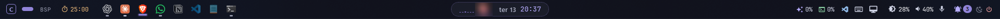
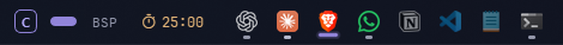
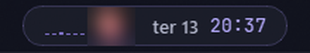
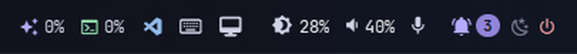
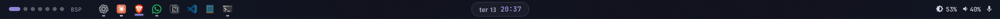
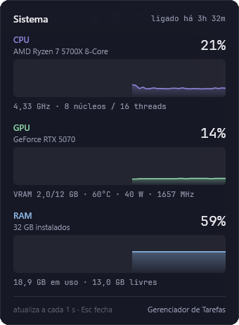
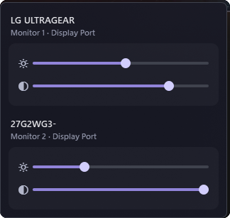
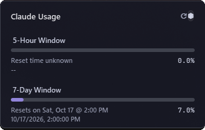
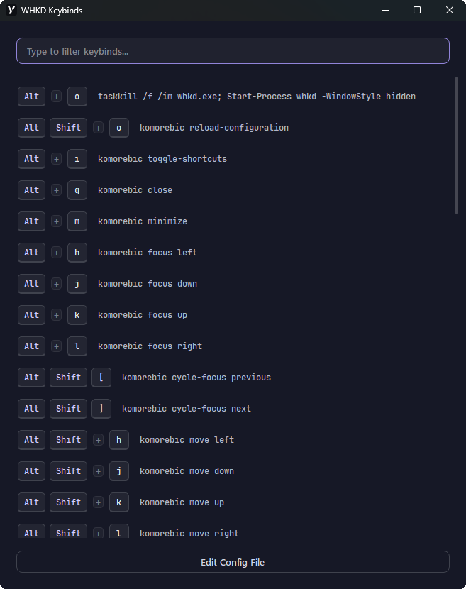

# cavalaridev-windows-setup

Configuração do meu Windows no tema **CavalariDev**: a barra de status [YASB](https://github.com/amnweb/yasb) e o tiling window manager [komorebi](https://github.com/LGUG2Z/komorebi), na paleta Nocturne da marca.



| Token | Cor |
|---|---|
| Fundo | `#161826` |
| Superfície | `#232532` |
| Texto | `#e9e9ed` |
| Acento | `#9184d9` |
| Verde / Azul / Âmbar | `#8ed6a8` / `#8fb9e8` / `#e3b478` |

## Estrutura

```
yasb/
  config.yaml        barras e widgets
  styles.css         tema (tokens no :root)
  assets/            indicadores de app aberto / em foco
  scripts/           popup de sistema (CPU/GPU/RAM) e modo fixar
  preview/           mockup interativo das barras (abre no navegador)
komorebi/
  komorebi.json      bordas, gaps, workspaces e regras de apps
  applications.json  regras por aplicativo
  whkdrc             atalhos de teclado (whkd)
docs/                prints usados neste README
```

## O que tem

### Monitor principal

Uma barra de ponta a ponta com acrylic, dividida em três partes.

**Esquerda:** a marca "C" (abre o menu do komorebi), os workspaces em pontos (o ativo vira uma barra blurple), o layout atual, as abas de stack, o pomodoro e os apps fixados. Embaixo de cada app fixado aparece uma linha cinza quando ele está aberto e uma linha blurple quando está em foco.



**Centro:** a ilha dinâmica, com visualizador de áudio, capa do que está tocando, data e hora. Clicar na capa abre o player, que mostra o app de origem.



**Direita:** uso do Claude e do Codex, projetos recentes do VS Code, cola de atalhos do whkd, ícone de PC (abre o popup de CPU, GPU e RAM), brilho via DDC/CI por monitor, volume, microfone, notificações, não perturbe e energia.



### Demais monitores

Uma barra leve: workspaces, apps fixados, data e hora, brilho, volume e microfone.



### Popups

| Sistema (ícone de PC) | Brilho por monitor | Uso do Claude |
|---|---|---|
|  |  |  |

**Cola de atalhos do whkd** (ícone de teclado), com busca:



### komorebi

- **Bordas:** 2 px, arredondadas, blurple na janela em foco e cinza nas outras.
- **Gaps:** 10 px entre as janelas.
- **Animações no estilo Hyprland:** as janelas se movem em 350 ms com a curva `CubicBezier(0.05, 0.9, 0.1, 1.05)`, a mesma dos temas do Hyprland (passa levemente do ponto e assenta), a 144 fps.
- **Janelas sem foco levemente transparentes:** alpha 235 (cerca de 92%), com a transição animada em 200 ms.
- **Claude desktop:** cadastrado como app *layered* e *tray*, pra entrar no layout.
- **Ignoradas:** as janelas do YASB (popups) e a `PseudoConsoleWindow` do Windows Terminal/WSL.

## Instalação

Requisitos: YASB 2.0.7+, komorebi 0.1.41+ com whkd e a fonte JetBrainsMono Nerd Font. O popup de GPU usa o `nvidia-smi`, que vem com o driver NVIDIA.

```powershell
# YASB
Copy-Item -Recurse -Force .\yasb\* "$env:USERPROFILE\.config\yasb\"

# komorebi + whkd
Copy-Item -Force .\komorebi\komorebi.json, .\komorebi\applications.json "$env:USERPROFILE\"
Copy-Item -Force .\komorebi\whkdrc "$env:USERPROFILE\.config\whkdrc"

komorebic start --whkd
yasbc reload
```

Pra o komorebi subir junto com o Windows:

```powershell
komorebic enable-autostart --whkd
```

### Ajustes depois de instalar

- **Caminhos absolutos.** O `config.yaml` e o `styles.css` apontam pra `C:/Users/felip/.config/yasb/...` (scripts do popup e imagens dos indicadores). Em outra máquina, troque `felip` pelo seu usuário.
- **Brilho.** O controle precisa de DDC/CI ligado no menu do monitor.
- **Uso do Claude.** O widget lê o login do `claude` CLI (`~/.claude/.credentials.json`).

## Como fixar apps na barra

A barra só mostra os apps fixados: os outros apps abertos ficam escondidos. Pra fixar um app novo, é preciso ligar o **modo fixar** por um momento, porque ele faz os apps abertos aparecerem na barra.

1. **Abra o app** que você quer fixar, por exemplo o Bloco de notas.
2. **Ligue o modo fixar:**
   ```powershell
   & "$env:USERPROFILE\.config\yasb\scripts\pin-mode.ps1"
   ```
   A barra recarrega, e os apps abertos não fixados aparecem com fundo âmbar.
3. **Clique com o botão direito** no ícone do app, na barra, e escolha **Pin to taskbar**.
4. **Repita** pra cada app que quiser fixar.
5. **Desligue o modo fixar** rodando o mesmo comando outra vez. Os apps não fixados voltam a ficar escondidos.

Notas:

- **Desafixar não precisa do modo fixar.** Os apps fixados já aparecem na barra: clique com o botão direito e escolha **Unpin from taskbar**.
- **A lista fica no YASB, fora deste repositório.** O arquivo é `%LOCALAPPDATA%\YASB\taskbar_pinned.json`. Em outra máquina, os apps precisam ser fixados de novo.
- **A ordem segue a ordem em que os apps foram fixados.** Dá pra arrastar os ícones na barra pra reordenar.

## Notas técnicas

- Os apps fixados são selecionados no CSS por `.app-container[pinned="true"]`: quando o app está aberto, o YASB tira a classe `pinned` do ícone, mas mantém essa propriedade. Os não fixados ficam com largura zero. Mudanças de tamanho no CSS só valem depois de um `yasbc reload` completo.
- No popup de mídia (`media_lite`), o padding precisa ir nos containers internos (`header`, `media-timeline-container`, `controls`); na janela do popup ele não tem efeito.
- O komorebi compara o nome do executável em minúsculas (`claude.exe`). Por isso a regra do Claude usa a regex `(?i)^claude\.exe$`.
- Os popups do YASB (como a lista de atalhos do whkd) são janelas comuns. Sem a regra `ignore_rules` para `yasb.exe`, o komorebi as encaixa no layout.
- O popup de sistema é um script WPF à parte (`scripts/sysmon.ps1`), aberto pelo `sysmon.vbs` sem piscar console. Ele só consome memória enquanto está aberto.
